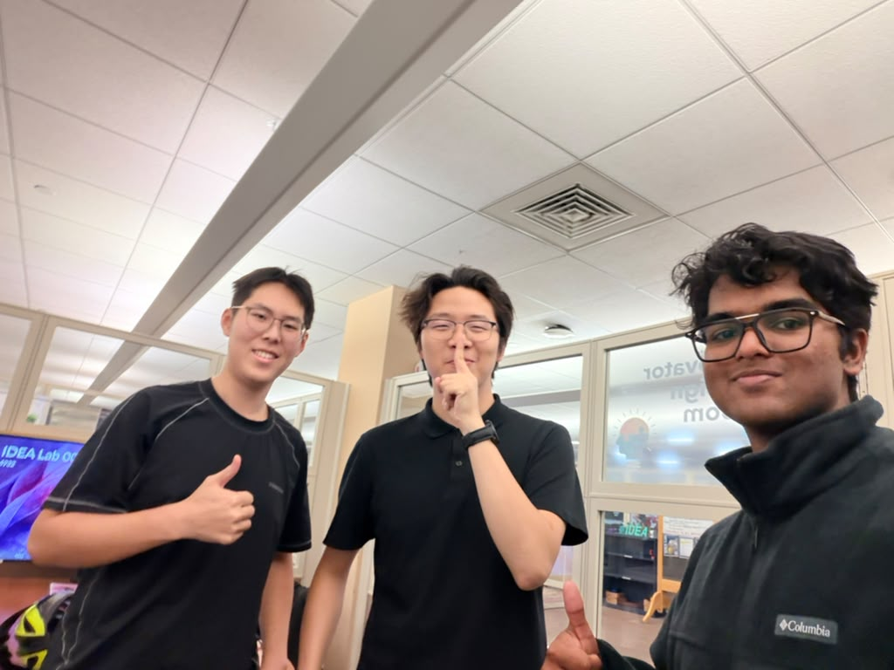

# F1 Compass

**Know before you work.** F1 Compass helps international students on F-1 visas check whether something they want to do (freelancing, a campus job, selling a book, accepting a hackathon prize) is likely allowed under U.S. work-authorization rules. Every answer is grounded in official government sources and comes with an email you can send to your school's international office.

> F1 Compass gives general information, not legal advice. Always confirm with your school's Designated School Official (DSO) before acting.

- **Live demo:** https://f1-compass.vercel.app (no sign-in needed)
- **Demo video:** _TODO: add YouTube URL_
- **Track:** Best Apps and Agents

## The problem

More than a million international students study in the U.S. Unauthorized work can end a student's F-1 status, yet the rules are scattered across USCIS pages, SEVP guidance and the Code of Federal Regulations. A tempting assumption is that freelance work is fine as long as the client or the bank account is abroad. Under F-1 rules, what usually matters is where the work is physically done.

## How it works

```
Student question  (+ optional: school international office site, home country)
   │
   ▼
1. Plan      NVIDIA Nemotron 3 Nano and Nemotron 3 Super race on Nebius Token Factory;
             the first to answer restates the situation, lists assumptions,
             and writes two search queries (backup queries if both take over 8 s)
   │
   ▼
2. Search    Tavily, restricted to official domains
             uscis.gov · ice.gov · studyinthestates.dhs.gov · ecfr.gov · irs.gov · …
             (+ the student's own school international office site, optional)
   │
   ▼
3. Analyze   NVIDIA Nemotron 3 Ultra (reasoning model) on Nebius Token Factory
             reads the sources and returns a verdict, cited explanation,
             legal paths (CPT/OPT), questions for the DSO and a ready-to-send email

   In parallel, if a home country was given:
             Nemotron 3 Super suggests three similar roles the student could take on
             while physically in that country, each with a job-search link
```

Progress streams to the browser as each step finishes. When the answer arrives, the page turns into the verdict: **Likely allowed**, **Authorization needed**, **Likely not allowed**, or **Unclear**, shown in color with an icon, and the reasons, legal paths, DSO questions and sources sit in collapsible sections below. The prompts tell the model to stay conservative, to cite only the sources it was given, and to answer in the student's own language.

## How we use NVIDIA and Nebius

- **Nebius Token Factory** hosts all three models. Every check makes runtime calls to the Token Factory inference API (`lib/nebius.ts`).
- **Three Nemotron models, each sized to its job.** The quick planning call goes to Nemotron 3 Nano and Nemotron 3 Super at the same time; whichever answers first is used and the other request is cancelled. We added the race after measuring Nano at 3 to 40 seconds during busy hours while Super stayed around 2 seconds. Nemotron 3 Ultra handles the reasoning-heavy legal analysis, and Super also writes the home-country suggestions.
- **Time limits on every call.** If neither planner answers within 8 seconds, the search runs on backup queries instead of waiting. The analysis call has its own limit, so a check never hangs past the hosting platform's function timeout.
- **Tavily** provides the search step (`lib/tavily.ts`), limited to official sources so the reasoning model works from authoritative text instead of forum posts. Each check runs two advanced searches, and identical searches are cached for a day to save credits. We tested basic search as a cheaper option: accuracy on our sample questions fell from 9/10 to 6/10, so we kept advanced.

## Accuracy

`evals/cases.csv` holds student questions with the answer F1 Compass should give and an official source for each. `npm run eval` runs them all against the app and counts **dangerous errors**: answering *likely allowed* when the right answer is anything else. That is the mistake that could hurt a student, so we tune for zero. See [evals/README.md](evals/README.md).

On the first 10 questions, runs since we tightened the verdict rules on Oct 20 scored between 7/10 and 9/10, with **no dangerous errors**. Our very first run, before that change, had one: it called accepting a hackathon prize "likely allowed" when the official sources don't address prizes. The full set of 30 questions is being written now. _TODO: add final results._

## Limitations and known issues

We think these are worth knowing before you rely on an answer:

- **It is not legal advice.** F1 Compass explains general rules and points to sources. Immigration outcomes depend on details it cannot see. Every answer tells the student to confirm with their DSO.
- **Answers can change between runs.** The verdict depends on which official pages the search returns, and those vary. Temperature 0 reduces the variation but does not remove it.
- **"Authorization needed" and "Likely not allowed" can blur.** For example, driving for a rideshare app has been labeled both ways across runs. Both mean "don't do this without CPT or OPT", but the second is more accurate when no realistic authorization path exists.
- **Thin sources lead to "Unclear".** Some activities, such as hackathon prizes or book royalties, are not addressed directly on official pages. By design the app answers "Unclear" instead of guessing.
- **The model sometimes mentions Special Student Relief** even when the student gave no reason to think it applies, despite a prompt rule against it.
- **Home-country suggestions are ideas, not job listings.** They come from the model, not from a job database. Platform names can be imprecise, and the app does not check the home country's labor or tax rules.
- **F-1 only.** J-1, M-1 and detailed OPT questions (such as unemployment-day limits) are not covered well yet.
- **Model latency varies.** When Nebius is busy, a check can take 20 seconds or more; the planner race and time limits keep it from hanging.
- **Languages.** We have tested English and Chinese questions; other languages should work but are untested.

## Accessibility

- Every control is a real button, link or form field and works from the keyboard. Ctrl/Cmd + Enter submits the question, and Escape closes the color picker.
- When the verdict appears, keyboard focus moves to the verdict heading so screen-reader users hear the answer first.
- The verdict is shown as text and an icon, never by color alone.
- Icon-only buttons have text labels, toggle buttons expose their state, and the reason sections use native disclosure elements.
- Animations turn off when the system asks for reduced motion.
- Light, dark and system color modes, plus five accent themes.
- Answers come back in the language of the question.
- We have not yet run a formal color-contrast audit.

## Run it locally

Requirements: Node.js 20 or newer.

```bash
npm install
cp .env.example .env.local   # then fill in your keys
npm run models               # lists the NVIDIA model IDs your Nebius key can use
npm run dev
```

Open http://localhost:3000.

### Environment variables

| Variable | Required | Description |
|---|---|---|
| `NEBIUS_API_KEY` | yes | API key from Nebius Token Factory |
| `TAVILY_API_KEY` | yes | API key from [Tavily](https://app.tavily.com) |
| `NEBIUS_FAST_MODEL` | no | First planner model ID (default `nvidia/NVIDIA-Nemotron-3-Nano-30B-A3B`) |
| `NEBIUS_FAST_MODEL_2` | no | Second planner model ID, raced against the first, also used for home-country suggestions (default `nvidia/nemotron-3-super-120b-a12b`) |
| `NEBIUS_REASONING_MODEL` | no | Analysis model ID (default `nvidia/Nemotron-3-Ultra-550b-a55b`) |
| `NEBIUS_PLAN_TIMEOUT_MS` | no | Wait this long for a planner before using backup queries (default `8000`) |
| `NEBIUS_ANALYSIS_TIMEOUT_MS` | no | Time limit for one analysis request (default `45000`) |
| `NEBIUS_BASE_URL` | no | Defaults to `https://api.tokenfactory.nebius.com/v1` |
| `TAVILY_SEARCH_DEPTH` | no | `advanced` (default, 2 credits per search) or `basic` (1 credit, less accurate in our tests) |
| `MOCK_MODE` | no | `1` streams canned sample data with no API calls, for UI work |

Model IDs vary by account. If a check fails with a "model not found" error, run `npm run models` and copy the exact IDs into `.env.local`.

## Deploy

1. Push this repository to GitHub.
2. Import it at [vercel.com/new](https://vercel.com/new).
3. Add `NEBIUS_API_KEY`, `TAVILY_API_KEY` and any model overrides as environment variables.
4. Deploy.

## Project structure

```
app/page.tsx                    page entry: passport backdrop + the app
app/layout.tsx                  fonts, and the head script that applies the saved theme before paint
app/api/check/route.ts          POST endpoint that streams progress as NDJSON
components/Compass.tsx          the UI: form, progress, verdict screen, sections, home-country card
components/ThemePicker.tsx      collapsible accent-color and light/dark picker
components/PassportBackdrop.tsx guilloche background and visa stamp (server-rendered)
lib/pipeline.ts                 plan race → search → analyze, plus home-country suggestions
lib/prompts.ts                  system prompts
lib/nebius.ts                   Token Factory client (OpenAI-compatible) with time limits and JSON retry
lib/tavily.ts                   official-source search with a one-day cache
lib/theme.ts                    theme storage and the pre-paint script
lib/mock.ts                     sample data for MOCK_MODE
evals/cases.csv                 test questions with expected answers
scripts/eval.mjs                runs the test questions and reports accuracy
scripts/list-models.mjs         lists NVIDIA models available to your key
```

## Team



Built by three students for the Nebius x NVIDIA Global AI Hackathon:

- [@kevinlionel874](https://github.com/kevinlionel874)
- [@Gall1um](https://github.com/Gall1um)
- [@winter-soldier25](https://github.com/winter-soldier25)

## License

[MIT](LICENSE)
